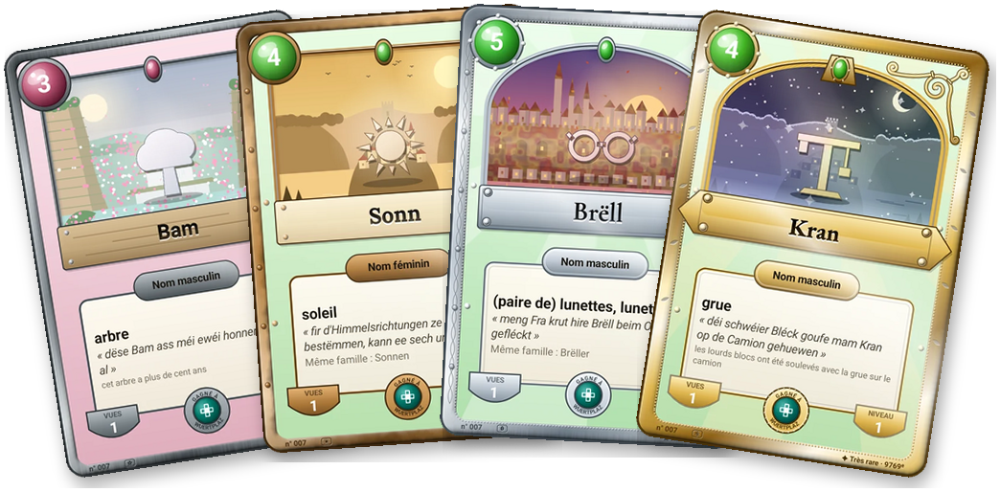






<nav class="site">
  <a href="index.html">🏠 Accueil</a> ·
  <a href="regle-du-jeu.html">🃏 Règle du jeu</a> ·
  <strong>🛒 Précommander</strong> ·
  <a href="faq.html">❓ Aide</a> ·
  <button type="button" class="theme-toggle" aria-label="Passer en mode sombre">🌙</button>
</nav>

# Précommander le jeu de cartes

Le <strong>Wuertduell</strong>, le jeu de cartes en
luxembourgeois : quatre boîtes de 54 cartes, à <strong>{{ page.prix }} la
boîte</strong>. On joue tout de suite, à deux, dès 6 ans.
Précommandez maintenant : l'impression part dès que
{{ page.objectif }} boîtes sont précommandées.Réservez les vôtres
<strong>sans rien payer</strong> : l'impression part dès que
{{ page.objectif }} boîtes sont réservées.

  

    {{ page.reservees }} boîtes précommandéeréservées
    sur {{ page.objectif }}
  

  

    
 0 %}6px0;background:var(--gradient);">

  

  
Chiffre au {{ page.reservees_au }}, mis à jour à la main.

<figure style="margin:20px auto;max-width:620px;text-align:center;">
  
  <figcaption>Les cartes du carnet de l'application, sur du vrai carton</figcaption>
</figure>

## Comment ça marche


1. **Vous précommandez** vos boîtes et vous payez, port compris.
2. **Dès que {{ page.objectif }} boîtes sont précommandées**, nous lançons
   l'impression et vous écrivons. Si l'objectif n'est pas atteint au
   **{{ page.date_limite }}**, vous êtes **remboursé en entier**.
3. **Vous recevez vos boîtes** {{ page.delai }}.

1. **Vous réservez** vos boîtes avec le formulaire ci-dessous. Vous ne payez
   rien, et réserver ne vous engage à rien.
2. **Dès que {{ page.objectif }} boîtes sont réservées**, nous vous écrivons
   pour confirmer votre réservation et la payer. L'impression part avec les
   paiements reçus.
3. **Vous recevez vos boîtes** {{ page.delai }}, chez vous ou lors d'une de
   nos animations au Luxembourg.


**Pourquoi une précommande ?** Imprimer en série coûte deux à trois fois moins
cher qu'imprimer chaque boîte à l'unité : c'est ce qui permet une boîte à
{{ page.prix }}. La précommande nous dit combien de boîtes imprimer, sans
avance et sans stock perdu.

## Les quatre boîtes

Chaque boîte contient **52 cartes à jouer**, deux paquets de 26 prêts à jouer
l'un contre l'autre, et **2 cartes de règle** : la Bataille des mots dès 6 ans,
et le Wuertduell dès 8 ans ([la règle complète](regle-du-jeu.html)). Elle
contient aussi **un code**, qui ajoute ses 52 cartes au carnet de
l'application. Les boîtes se jouent seules ou ensemble, et aucun mot n'est
dans deux boîtes.

**🔴 La boîte de départ**, *Déieren* contre *Iessen* : les animaux contre ce
qu'on mange.

**🟢 L'extension *Schoul* et *Natur*** : l'école (*Buch*, *Heft*,
*Schoulsak*, *liesen*, *schreiwen*…) contre la nature (*Bam*, *Sonn*,
*Mound*, les saisons, *gréng*, *waarm*…).

**🔵 Niveau A1**, *Doheem* contre *Dobaussen* : les premiers mots, à la maison
(*Fra*, *Kand*, *Apel*, *Kaffi*, *Famill*…) et dehors (*Bus*, *Vëlo*, *Büro*,
*Noper*, *Apdikt*…).

**🟣 Niveau A2**, *Doheem* contre *Dobaussen* : la suite, à la maison
(*Haus*, *Gaart*, *Hand*, *Häerz*, *Schong*…) et dehors (*Gare*, *Tram*,
*Duerf*, *Rees*, *Schnéi*…).

Toutes les cartes sont au format poker (63 × 88 mm). Les mots, leurs sens et
leurs phrases viennent du [Lëtzebuerger Online Dictionnaire](https://lod.lu),
le dictionnaire officiel du Zenter fir d'Lëtzebuerger Sprooch.


## Précommander

{{ page.prix }} la boîte, port en plus.

<a href="{{ page.stripe_lien }}" class="btn-installer">🛒 Précommander mes boîtes</a>

Paiement sécurisé par Stripe, qui vous demande l'adresse de
livraison et le nombre de boîtes de chaque sorte. Si l'objectif n'est pas
atteint au {{ page.date_limite }}, vous êtes remboursé en entier. Vous pouvez
renoncer à votre achat dans les 14 jours qui suivent la réception.
<a href="conditions-de-vente.html">Conditions de vente</a> ·
<a href="conditions-de-vente.html#donnees">Vos données</a>

### Sur le produit

- Jeux de cartes pour enfants **dès 6 ans** (Wuertduell dès 8 ans).
- Vendeur et fabricant : {{ page.fabricant }}

## Réserver mes boîtes

<form id="reservation" action="https://formspree.io/f/mvgwnlky" method="POST" style="margin:16px 0;">
  <input type="hidden" name="_subject" value="Réservation : Wuertduell">
  <input type="hidden" name="liste" value="precommande-wuertduell">
  <fieldset style="margin:0 0 14px;padding:0;border:0;">
    <legend style="padding:0;font-weight:600;">Combien de boîtes ?</legend>
    
{{ page.prix }} la boîte, port en plus. Rien à payer aujourd'hui.

    
    
    

      <input id="q-{{ champ[0] }}" class="quantite" type="number" name="{{ champ[0] }}" min="0" max="20" step="1" inputmode="numeric" value="10"
             style="width:72px;padding:8px;font-size:17px;border:1px solid var(--line);border-radius:8px;background:var(--card);color:var(--ink);">
      <label for="q-{{ champ[0] }}">{{ champ[1] }}</label>
    

    
    

  </fieldset>
  

    <label for="reservation-email">Votre e-mail</label> 
    <input id="reservation-email" type="email" name="email" required autocomplete="email"
           style="width:100%;max-width:360px;padding:10px;font-size:17px;border:1px solid var(--line);border-radius:8px;background:var(--card);color:var(--ink);">
  

  

    <label for="reservation-pays">Pays de livraison</label> 
    <select id="reservation-pays" name="pays"
            style="padding:10px;font-size:17px;border:1px solid var(--line);border-radius:8px;background:var(--card);color:var(--ink);">
      <option>Luxembourg</option>
      <option>Belgique</option>
      <option>France</option>
      <option>Allemagne</option>
      <option>Un autre pays</option>
    </select>
  

  <fieldset style="margin:0 0 14px;padding:0;border:0;">
    <legend style="padding:0;">Comment recevoir vos boîtes ?</legend>
    <label><input type="radio" name="reception" value="livraison" checked> Livrées chez moi (port en plus)</label> 
    <label><input type="radio" name="reception" value="retrait"> Retirées lors d'une animation ou d'un stand au Luxembourg (sans frais)</label>
  </fieldset>
  <button type="submit" class="btn-installer" style="border:0;cursor:pointer;">📦 Réserver, sans payer</button>
  

</form>

Votre adresse sert seulement à vous écrire quand l'impression
se prépare, pour confirmer et payer votre réservation, puis elle est effacée
après la livraison, ou tout de suite si le projet n'aboutit pas. Réserver ne
vous engage à rien. Le formulaire est hébergé par
<a href="https://formspree.io/legal/privacy-policy">Formspree</a>, comme celui
des avis sur l'application.



## Livraison

Au **Luxembourg**, en **Belgique**, en **France** et en **Allemagne**, port
en plus, communiqué avant le paiement. Au
Luxembourg, vous pouvez aussi **retirer vos boîtes sans frais** lors d'une de
nos animations ou d'un stand.

## Gratuit, pour toujours

- **L'application** Lëtzebuergesch Clavier : le clavier, le Wierderbuch, le
  carnet et les jeux. [L'installer](index.html#installer).
- **Les cartes à imprimer**, pour les écoles, les animations et pour apprendre
  chez soi : [les fichiers](https://github.com/famibelle/LuxKeyb/tree/main/cartes-imprimables).
  Les boîtes ajoutent le vrai carton, la boîte prête à jouer et le code des
  cartes pour le carnet.

## En attendant

Lisez [la règle du jeu](regle-du-jeu.html), et commencez la collection dans le
carnet de [l'application](index.html#installer) : chaque mot que vous tapez en
luxembourgeois peut devenir une carte.
