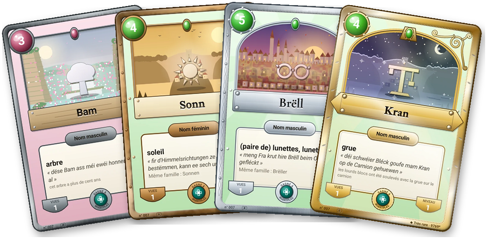

<nav class="site">
  <a href="index.html">🏠 Accueil</a> ·
  <a href="regle-du-jeu.html">🃏 Règle du jeu</a> ·
  <strong>🛒 Commander</strong> ·
  <a href="faq.html">❓ Aide</a> ·
  <button type="button" class="theme-toggle" aria-label="Passer en mode sombre">🌙</button>
</nav>

# Commander le jeu de cartes

Le <strong>Wuertduell</strong> : 54 cartes en luxembourgeois,
imprimées à la demande et livrées chez vous. On joue tout de suite, à deux,
dès 6 ans.

<figure style="margin:20px auto;max-width:620px;text-align:center;">
  
  <figcaption>Les cartes du carnet de l'application, sur du vrai carton</figcaption>
</figure>

## Dans la boîte

- **52 cartes à jouer** : deux paquets de 26, *Déieren* (les animaux) et
  *Iessen* (ce qu'on mange), prêts à jouer l'un contre l'autre.
- **2 cartes de règle** : la Bataille des mots, dès 6 ans, et le Wuertduell,
  dès 8 ans. La règle complète est [en ligne](regle-du-jeu.html).
- **Un code par e-mail**, un par boîte : scanné dans le carnet de
  l'application, il y ajoute les 52 cartes de la boîte.

Format poker (63 × 88 mm). Les mots, leurs sens et leurs phrases viennent du
[Lëtzebuerger Online Dictionnaire](https://lod.lu).

## Livraison

Au **Luxembourg**, en **Belgique**, en **France** et en **Allemagne**. Chaque
boîte est imprimée pour vous, puis envoyée directement chez vous : comptez
{{ page.delai }}.


## Commander

{{ page.prix }}

<a href="{{ page.stripe_lien }}" class="btn-installer">🛒 Commander</a>

Paiement sécurisé par Stripe, qui vous demande l'adresse de
livraison. Vous pouvez renoncer à votre achat dans les 14 jours qui suivent la
réception. <a href="conditions-de-vente.html">Conditions de vente</a> ·
<a href="conditions-de-vente.html#donnees">Vos données</a>

### Sur le produit

- Jeu de cartes pour enfants **dès 6 ans** (Wuertduell dès 8 ans).
- Vendeur et fabricant : {{ page.fabricant }}

## Un e-mail à la sortie

Le jeu imprimé est en préparation. Laissez votre adresse : vous recevrez **un
seul e-mail**, le jour où les commandes ouvrent.

<form id="attente" action="https://formspree.io/f/mvgwnlky" method="POST" style="margin:16px 0;">
  <input type="hidden" name="_subject" value="Liste d'attente : boîte Wuertduell">
  <input type="hidden" name="liste" value="boite-wuertduell">
  

    <label for="attente-email">Votre e-mail</label> 
    <input id="attente-email" type="email" name="email" required autocomplete="email"
           style="width:100%;max-width:360px;padding:10px;font-size:17px;border:1px solid var(--line);border-radius:8px;background:var(--card);color:var(--ink);">
  

  

    <label for="attente-pays">Pays de livraison</label> 
    <select id="attente-pays" name="pays"
            style="padding:10px;font-size:17px;border:1px solid var(--line);border-radius:8px;background:var(--card);color:var(--ink);">
      <option>Luxembourg</option>
      <option>Belgique</option>
      <option>France</option>
      <option>Allemagne</option>
      <option>Un autre pays</option>
    </select>
  

  <button type="submit" class="btn-installer" style="border:0;cursor:pointer;">🔔 Me prévenir</button>
  

</form>

Votre adresse sert seulement à vous prévenir de l'ouverture
des commandes, puis elle est effacée. Le formulaire est hébergé par
<a href="https://formspree.io/legal/privacy-policy">Formspree</a>, comme celui
des avis sur l'application.



## En attendant

Lisez [la règle du jeu](regle-du-jeu.html), et commencez la collection dans
le carnet de [l'application](index.html#installer) : chaque mot que vous tapez
en luxembourgeois peut devenir une carte.
