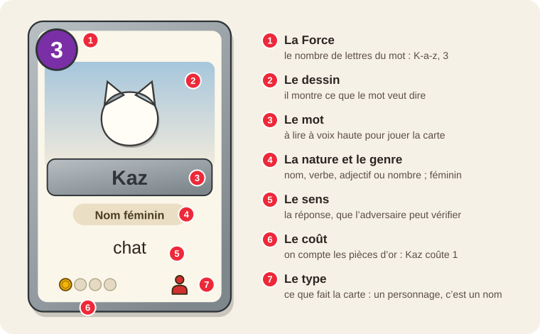
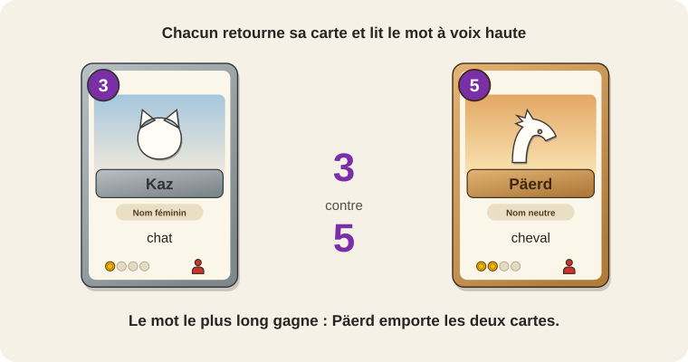
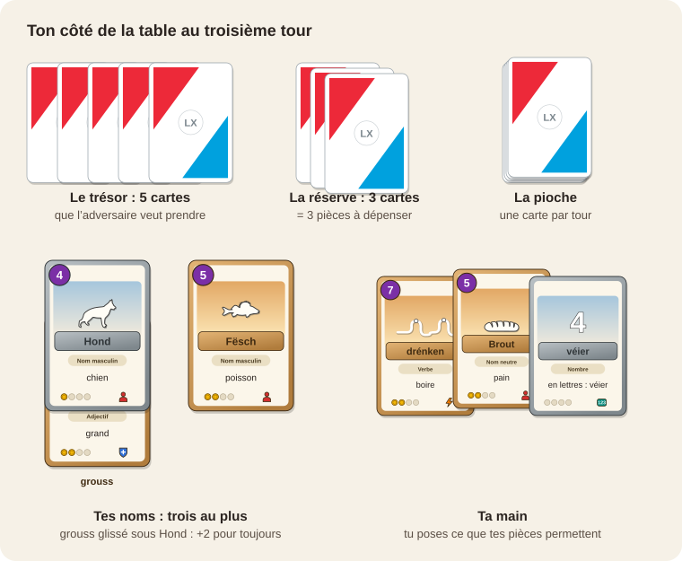
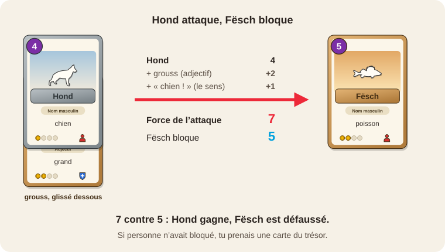

<nav class="site">
  <a href="index.html">🏠 Accueil</a> ·
  <a href="index.html#installer">📲 Installer</a> ·
  <a href="simulateur.html">⌨️ Essayer en ligne</a> ·
  <a href="guide.html">📘 Guide</a> ·
  <strong>🃏 Règle du jeu</strong> ·
  <a href="commander.html">🛒 Commander</a> ·
  <a href="faq.html">❓ Aide</a> ·
  <button type="button" class="theme-toggle" aria-label="Passer en mode sombre">🌙</button>
</nav>

# Règle du jeu

*Les cartes du carnet se jouent aussi sur la table, à deux, comme un jeu de
cartes à collectionner, mais avec des règles qu'un enfant comprend en deux
minutes.*

Tous les mots, leurs sens, leurs genres et leurs phrases d'exemple viennent du
[Lëtzebuerger Online Dictionnaire](https://lod.lu), le dictionnaire officiel du
Zenter fir d'Lëtzebuerger Sprooch : des milliers de mots à jouer, de *Kaz* à
*Krokodil*.

Le jeu imprimé est en préparation : voici la règle, pour l'essayer et nous dire
ce qu'elle vaut. [Laissez votre adresse](commander.html) : nous vous écrirons à sa
sortie, pour le recevoir chez vous.

## Il te faut

**Des cartes, et rien d'autre.** Ni dé, ni jeton, ni crayon : tout ce qui sert
à jouer est imprimé sur les cartes, et tout ce qu'on gagne, ce sont des cartes.

## Tout se lit sur la carte

| Sur la carte | Dans le jeu |
|---|---|
| Le chiffre de la pastille, en haut à gauche (le nombre de lettres du mot) | La **Force** : *Kaz* 3, *Fierkel* 7, *Päiperlek* 9 |
| Les pièces d'or de la jauge, en bas à gauche | Le **coût** : on les compte, de 0 à 4 |
| L'image en bas à droite : un personnage (nom), un éclair (verbe), un bouclier « + » (adjectif), « 123 » (nombre) | Ce que fait la carte |
| Le genre du nom, sur la pastille : masculin, féminin ou neutre | La **famille** de la carte |
| Le sens du mot, en français (ou dans la langue de ton édition) | La réponse, que l'adversaire peut vérifier |
| La phrase d'exemple | Un bonus pour les grands lecteurs |
| L'image du médaillon, en bas au milieu | Le paquet de la carte, pour la ranger après la partie |
| Les étoiles, en bas à droite, de ★☆☆☆☆ à ★★★★★ | Rien : plus il y a d'étoiles pleines, plus la carte est rare |

<figure style="margin:20px auto;max-width:760px;text-align:center;">
  
  <figcaption>Tout ce qui sert à jouer est écrit sur la carte</figcaption>
</figure>

**Une règle d'or : pour jouer une carte, on lit son mot à voix haute.**

## Niveau 1 : la Bataille des mots

*Dès 6 ans · 2 joueurs · 5 minutes*

1. Mélangez toutes les cartes, par exemple les 52 cartes de la boîte, et
   partagez-les en deux paquets, faces cachées.
2. Chaque joueur retourne la première carte de son paquet et lit le mot à voix
   haute.
3. Le mot le plus long gagne : son joueur prend les deux cartes et les met
   sous son paquet.
4. En cas d'égalité, le premier qui dit le sens du mot emporte les
   deux cartes.

Celui qui a toutes les cartes a gagné. On peut aussi s'arrêter au bout de dix
manches : celui qui a le plus de cartes a gagné.

<figure style="margin:20px auto;max-width:760px;text-align:center;">
  
  <figcaption>Une manche : Päerd a deux lettres de plus que Kaz</figcaption>
</figure>

## Niveau 2 : le Wuertduell

*Dès 8 ans · 2 joueurs · 15 minutes*

### Pour commencer

Chaque joueur prend un paquet de **26 cartes** et le mélange : l'un des deux
paquets de la boîte, ou celui qu'il a composé (voir [Les paquets](#les-paquets)).

- Il pose les **5 premières cartes faces cachées** devant lui, sans les
  regarder : c'est son **trésor**.
- Il pioche les 5 suivantes : c'est sa **main**.
- Le reste forme sa **pioche**.

<figure style="margin:20px auto;max-width:760px;text-align:center;">
  
  <figcaption>Ta table de jeu au troisième tour</figcaption>
</figure>

### À ton tour

1. **Pioche** une carte.
2. **Remplis ta réserve.** Pose une carte de ta main face cachée sur le côté :
   c'est ta **réserve**. Une seule par tour. Chaque carte de ta réserve te donne
   **1 pièce** à dépenser à chaque tour.
3. **Pose des cartes**, autant que tes pièces le permettent : une carte coûte
   autant de pièces qu'elle en montre, de 1 à 4. Lis le mot à voix haute.
   - Un **nom** est un personnage : il se pose devant toi. Trois au plus.
   - Un **verbe** est une action : +3 de Force à l'un de tes noms pour ce tour,
     puis la carte est défaussée.
   - Un **adjectif** se glisse sous l'un de tes noms : +2 de Force pour toujours.
     *grouss* sous *Hond*, et voilà un grand chien.
   - Un **nombre** ne coûte rien : dis-le en luxembourgeois, et il te donne
     1 pièce de plus pour ce tour. Puis il est défaussé.
4. **Attaque** avec chacun des noms que tu avais déjà posés au tour d'avant.
   - L'adversaire peut **bloquer** avec l'un des siens : la plus grande Force
     gagne, l'autre carte est défaussée. En cas d'égalité, les deux le sont.
   - Si personne ne bloque, tu prends **une carte du trésor** de ton
     adversaire, sans la regarder, et tu la poses à côté de toi.

<figure style="margin:20px auto;max-width:760px;text-align:center;">
  
  <figcaption>Un combat : 7 contre 5</figcaption>
</figure>

### Les bonus

- **La famille.** Deux de tes noms ont le même genre, écrit sur leur pastille :
  chacun gagne +1. *d'Kaz* et *d'Ameis* sont toutes les deux féminines, *den
  Hond* et *de Léiw* tous les deux masculins. Un nom qui a deux genres, comme
  *Krokodil* (masculin ou neutre), est des deux familles.
- **Le sens.** Tu dis le sens du nom qui attaque : il gagne +1. Ton adversaire
  vérifie sur la carte.
- **Pour les grands lecteurs.** Tu lis à voix haute la phrase d'exemple du nom
  qui attaque : il gagne encore +1.

### Les cartes spéciales

Les cartes des sept jeux ont chacune un pouvoir écrit dessus. La carte ultra
rare de la **Fierkelsmaart** prend une carte du trésor de l'adversaire, une
fois par partie.

### Pour gagner

**Prends les 5 cartes du trésor de ton adversaire.** Celui qui n'a plus de
trésor a perdu. Si ta pioche est vide, tu continues sans piocher.

## Les paquets {#les-paquets}

### La boîte

La boîte contient **52 cartes à jouer**, comme un jeu de cartes classique :
**deux paquets de 26 cartes**, prêts à jouer. Les deux cartes de plus, à la
place des jokers, résument la règle des deux jeux. L'une porte aussi un
**code** : scanné dans le carnet de l'application (« Recevoir », puis « Le code
d'une carte en papier »), il y ajoute les 52 cartes de la boîte.

Les deux paquets :

- **Déieren**, les animaux : *Kaz*, *Hond*, *Päerd*, *Fësch*, *Elefant*,
  *Krokodil*…
- **Iessen**, ce qu'on mange : *Brout*, *Kéis*, *Mëllech*, *Banann*, *Tomat*,
  *Hieselnoss*…

Chacun a 14 noms, 5 verbes (*iessen*, *lafen*, *sangen*, *schwammen*…),
4 adjectifs (*grouss*, *kleng*, *staark*, *witzeg*…) et 3 nombres. Chaque nom
d'un paquet a son jumeau de même Force dans l'autre : aucun des deux n'est
avantagé.

### Les extensions

Des paquets à thème s'ajoutent à la boîte : **Schoul** (l'école : *Buch*,
*Heft*, *Schoulsak*…) et **Natur** (*Bam*, *Sonn*, *Mound*, *Reen*…), puis
d'autres, puisque le dictionnaire ne manque pas de mots. Elles se commandent
avec la boîte, [sur la page Commander](commander.html).

### Composer son paquet

Avec les extensions, chacun peut composer le sien :

- **26 cartes** exactement ;
- **au moins la moitié de noms** ;
- **un seul exemplaire** de chaque mot.
